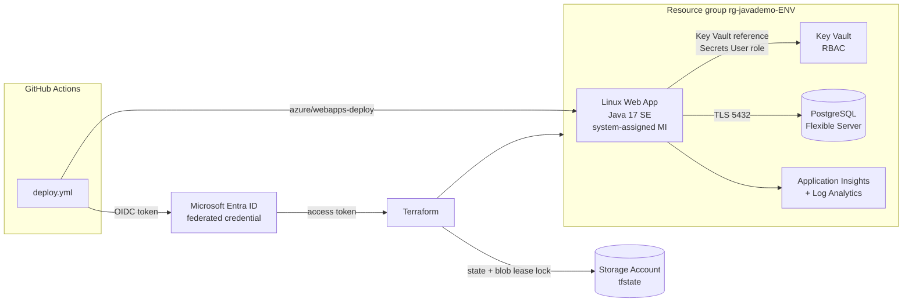

# azure-java-terraform

[](https://github.com/18-ashish-sharma/azure-java-terraform/actions/workflows/terraform.yml)
[](https://github.com/18-ashish-sharma/azure-java-terraform/actions/workflows/app.yml)


Terraform that runs a Java 17 Spring Boot service on **Azure App Service (Linux)** backed by
**PostgreSQL Flexible Server**. The database password is generated by Terraform, stored only
in **Key Vault**, and read by the app through its **managed identity**. GitHub Actions
deploys with **OIDC**, so no cloud secret is stored in the repo or in GitHub.

## Architecture



## Repository layout

```
.
├── src/                            Spring Boot sample: GET /api/hello, /actuator/health
├── pom.xml, mvnw                   Maven build (wrapper pinned to 3.9.10)
├── terraform/
│   ├── modules/java-webapp/        Everything for one environment (reusable module)
│   └── environments/
│       ├── dev/                    One root per environment, own state file
│       ├── stage/
│       └── prod/
├── .tflint.hcl                     tflint + azurerm ruleset
├── .github/workflows/
│   ├── terraform.yml               fmt, validate, tflint, checkov (PR + main, no credentials)
│   ├── app.yml                     Maven build + tests (PR + main)
│   └── deploy.yml                  Manual: plan -> approval -> apply -> deploy jar (OIDC)
└── azuredevops/                    Same build and provisioning flow for Azure Pipelines
```

**Why a directory per environment instead of workspaces?** Each environment has its own
state file and backend key, and can run a different module or provider version during a
rollout. A `plan` in `dev/` cannot touch prod because someone had the wrong workspace
selected, and the differences between environments (SKUs, backup retention) are visible in
code review. The shared module keeps the three roots small. Per-person or per-region
tweaks go in a `-var-file`.

## Prerequisites

- Terraform >= 1.6, Azure CLI, Java 17 (the Maven wrapper downloads Maven)
- An Azure subscription where you can create resources **and role assignments**
  (Owner, or Contributor + Role Based Access Control Administrator), because the module
  grants Key Vault roles
- A storage account for remote state (one-time):

```bash
az group create -n rg-tfstate -l centralindia
az storage account create -n <unique-name> -g rg-tfstate --sku Standard_LRS \
  --min-tls-version TLS1_2 --allow-blob-public-access false
az storage container create -n tfstate --account-name <unique-name> --auth-mode login
# Your user / the CI identity needs "Storage Blob Data Contributor" on this account.
```

## Run locally

```bash
az login
export ARM_SUBSCRIPTION_ID=$(az account show --query id -o tsv)   # azurerm 4.x needs it

cd terraform/environments/dev
cp backend.hcl.example backend.hcl        # set storage_account_name; drop use_oidc locally
cp example.tfvars dev.tfvars              # both copies are git-ignored

terraform init -backend-config=backend.hcl
terraform plan  -var-file=dev.tfvars -out=tfplan
terraform apply tfplan

# Build and deploy the app
cd ../../.. && ./mvnw -B verify
az webapp deploy -g "$(terraform -chdir=terraform/environments/dev output -raw resource_group_name)" \
  -n "$(terraform -chdir=terraform/environments/dev output -raw web_app_name)" \
  --src-path target/app.jar --type jar
curl "$(terraform -chdir=terraform/environments/dev output -raw web_app_url)/api/hello?name=azure"
```

Run the app on your machine against a local PostgreSQL:

```bash
DB_HOST=localhost DB_NAME=demo DB_USER=demo DB_PASSWORD=demo DB_SSLMODE=disable ./mvnw spring-boot:run
curl localhost:8080/api/hello
```

## CI/CD

| Workflow | Trigger | Credentials | What it does |
|---|---|---|---|
| `terraform.yml` | PR, push to `main` | none | `fmt -check`, `init -backend=false` + `validate` for the module and each root, `tflint`, `checkov` (SARIF to the Security tab) |
| `app.yml` | PR, push to `main` | none | `./mvnw verify` on Temurin 17, uploads `app.jar` |
| `deploy.yml` | manual (`workflow_dispatch`, pick env) | OIDC | build -> `terraform plan` (saved plan) -> **approval** on the GitHub environment -> `apply` that exact plan -> deploy jar -> smoke test `/actuator/health` |

### One-time OIDC setup

GitHub issues a short-lived token per job; Entra ID trusts it through a federated
credential, so there is no client secret to store or rotate.

```bash
APP_ID=$(az ad app create --display-name gh-azure-java-terraform --query appId -o tsv)
az ad sp create --id "$APP_ID"
SUB=$(az account show --query id -o tsv)
REPO=18-ashish-sharma/azure-java-terraform

# Permissions: create resources + the Key Vault role assignments the module makes.
az role assignment create --assignee "$APP_ID" --role Contributor --scope "/subscriptions/$SUB"
az role assignment create --assignee "$APP_ID" --role "Role Based Access Control Administrator" \
  --scope "/subscriptions/$SUB"
az role assignment create --assignee "$APP_ID" --role "Storage Blob Data Contributor" \
  --scope "$(az storage account show -n <unique-name> -g rg-tfstate --query id -o tsv)"

# The plan job runs on main without an environment; the apply job runs in an environment.
# The token subject differs, so each needs its own federated credential.
az ad app federated-credential create --id "$APP_ID" --parameters "{
  \"name\": \"main\", \"issuer\": \"https://token.actions.githubusercontent.com\",
  \"subject\": \"repo:$REPO:ref:refs/heads/main\", \"audiences\": [\"api://AzureADTokenExchange\"]}"
for ENV in dev stage prod; do
  az ad app federated-credential create --id "$APP_ID" --parameters "{
    \"name\": \"env-$ENV\", \"issuer\": \"https://token.actions.githubusercontent.com\",
    \"subject\": \"repo:$REPO:environment:$ENV\", \"audiences\": [\"api://AzureADTokenExchange\"]}"
done
```

In GitHub:

- **Repository secrets**: `AZURE_CLIENT_ID` (= `$APP_ID`), `AZURE_TENANT_ID`, `AZURE_SUBSCRIPTION_ID`
- **Repository variables**: `TFSTATE_RESOURCE_GROUP`, `TFSTATE_STORAGE_ACCOUNT`
- **Environments** `dev`, `stage`, `prod`: add required reviewers (at least on `prod`) and
  limit deployment branches to `main`

`deploy.yml` fails until this is done; `terraform.yml` and `app.yml` need nothing.

## Security notes

- **No secrets in the repo or in CI.** GitHub -> Azure uses OIDC instead of a client secret.
  `*.tfvars`, `backend.hcl` and state are git-ignored.
- **Database password**: generated by `random_password` and written to Key Vault. The web app
  setting is `@Microsoft.KeyVault(SecretUri=...)`, resolved at runtime with the app's
  system-assigned managed identity, which has only *Key Vault Secrets User*. The password is
  still in Terraform state, which is why state lives in a private storage account with
  Entra ID auth.
- **Key Vault** uses Azure RBAC (no access policies), soft delete and purge protection.
- **Transport**: `https_only`, TLS 1.2 minimum, FTPS disabled, PostgreSQL
  `require_secure_transport = on`, and the app connects with `sslmode=require`.
- **Network**: PostgreSQL allows only the "Azure services" firewall rule (`0.0.0.0`), not the
  internet. For production the next step is VNet integration on the web app, PostgreSQL with
  private access in a delegated subnet, and a private endpoint for Key Vault.
- **Actuator** exposes only `health` and `info`.
- Checkov findings that do not apply are skipped inline, each with its reason, next to the
  resource.

## Cost notes

SKUs are chosen per environment in `terraform/environments/*/variables.tf`. Check the Azure
pricing calculator for current prices.

| Resource | dev / stage | prod |
|---|---|---|
| App Service plan | B1 (1 vCPU, 1.75 GB) | P0v3 |
| PostgreSQL Flexible Server | B_Standard_B1ms (burstable), 32 GB, 7-day backups | GP_Standard_D2ds_v5, 35-day geo-redundant backups |
| Key Vault, Application Insights | pay per operation / GB ingested | same |

- Stop the database while dev is idle: `az postgres flexible-server stop -g <rg> -n <server>`
  (Azure starts it again automatically after 7 days).
- `terraform destroy` in `dev/` removes everything; the Key Vault stays soft-deleted for
  7 days at no cost.

## Module reference

<!-- BEGIN_TF_DOCS -->
## Requirements

| Name | Version |
| ---- | ------- |
| <a name="requirement_terraform"></a> [terraform](#requirement\_terraform) | >= 1.6 |
| <a name="requirement_azurerm"></a> [azurerm](#requirement\_azurerm) | ~> 4.0 |
| <a name="requirement_random"></a> [random](#requirement\_random) | ~> 3.6 |
| <a name="requirement_time"></a> [time](#requirement\_time) | ~> 0.12 |

## Modules

No modules.

## Resources

| Name | Type |
| ---- | ---- |
| [azurerm_application_insights.this](https://registry.terraform.io/providers/hashicorp/azurerm/latest/docs/resources/application_insights) | resource |
| [azurerm_key_vault.this](https://registry.terraform.io/providers/hashicorp/azurerm/latest/docs/resources/key_vault) | resource |
| [azurerm_key_vault_secret.db_password](https://registry.terraform.io/providers/hashicorp/azurerm/latest/docs/resources/key_vault_secret) | resource |
| [azurerm_linux_web_app.this](https://registry.terraform.io/providers/hashicorp/azurerm/latest/docs/resources/linux_web_app) | resource |
| [azurerm_log_analytics_workspace.this](https://registry.terraform.io/providers/hashicorp/azurerm/latest/docs/resources/log_analytics_workspace) | resource |
| [azurerm_postgresql_flexible_server.this](https://registry.terraform.io/providers/hashicorp/azurerm/latest/docs/resources/postgresql_flexible_server) | resource |
| [azurerm_postgresql_flexible_server_configuration.require_tls](https://registry.terraform.io/providers/hashicorp/azurerm/latest/docs/resources/postgresql_flexible_server_configuration) | resource |
| [azurerm_postgresql_flexible_server_database.app](https://registry.terraform.io/providers/hashicorp/azurerm/latest/docs/resources/postgresql_flexible_server_database) | resource |
| [azurerm_postgresql_flexible_server_firewall_rule.azure_services](https://registry.terraform.io/providers/hashicorp/azurerm/latest/docs/resources/postgresql_flexible_server_firewall_rule) | resource |
| [azurerm_resource_group.this](https://registry.terraform.io/providers/hashicorp/azurerm/latest/docs/resources/resource_group) | resource |
| [azurerm_role_assignment.deployer_secrets_officer](https://registry.terraform.io/providers/hashicorp/azurerm/latest/docs/resources/role_assignment) | resource |
| [azurerm_role_assignment.webapp_secrets_user](https://registry.terraform.io/providers/hashicorp/azurerm/latest/docs/resources/role_assignment) | resource |
| [azurerm_service_plan.this](https://registry.terraform.io/providers/hashicorp/azurerm/latest/docs/resources/service_plan) | resource |
| [random_password.postgres_admin](https://registry.terraform.io/providers/hashicorp/random/latest/docs/resources/password) | resource |
| [random_string.suffix](https://registry.terraform.io/providers/hashicorp/random/latest/docs/resources/string) | resource |
| [time_sleep.wait_for_rbac](https://registry.terraform.io/providers/hashicorp/time/latest/docs/resources/sleep) | resource |
| [azurerm_client_config.current](https://registry.terraform.io/providers/hashicorp/azurerm/latest/docs/data-sources/client_config) | data source |

## Inputs

| Name | Description | Type | Default | Required |
| ---- | ----------- | ---- | ------- | :------: |
| <a name="input_app_name"></a> [app\_name](#input\_app\_name) | Short application name used as a prefix for every resource (lowercase letters and digits, 3-10 chars). | `string` | `"javademo"` | no |
| <a name="input_app_service_sku"></a> [app\_service\_sku](#input\_app\_service\_sku) | App Service plan SKU, e.g. B1 (dev), P0v3 (prod). | `string` | `"B1"` | no |
| <a name="input_database_name"></a> [database\_name](#input\_database\_name) | Name of the application database. | `string` | `"appdb"` | no |
| <a name="input_environment"></a> [environment](#input\_environment) | Deployment environment. | `string` | n/a | yes |
| <a name="input_health_check_path"></a> [health\_check\_path](#input\_health\_check\_path) | Path App Service probes to decide whether an instance is healthy. | `string` | `"/actuator/health"` | no |
| <a name="input_java_version"></a> [java\_version](#input\_java\_version) | Java SE runtime version for the Linux web app. | `string` | `"17"` | no |
| <a name="input_location"></a> [location](#input\_location) | Azure region for all resources. | `string` | `"centralindia"` | no |
| <a name="input_log_retention_days"></a> [log\_retention\_days](#input\_log\_retention\_days) | Retention for the Log Analytics workspace behind Application Insights. | `number` | `30` | no |
| <a name="input_postgres_admin_login"></a> [postgres\_admin\_login](#input\_postgres\_admin\_login) | Administrator login for the PostgreSQL server. The password is generated and kept in Key Vault. | `string` | `"pgadmin"` | no |
| <a name="input_postgres_backup_retention_days"></a> [postgres\_backup\_retention\_days](#input\_postgres\_backup\_retention\_days) | Point-in-time restore window in days (7-35). | `number` | `7` | no |
| <a name="input_postgres_geo_redundant_backup"></a> [postgres\_geo\_redundant\_backup](#input\_postgres\_geo\_redundant\_backup) | Store backups in the paired region as well. Cannot be changed after the server is created. | `bool` | `false` | no |
| <a name="input_postgres_sku"></a> [postgres\_sku](#input\_postgres\_sku) | Flexible Server SKU, e.g. B\_Standard\_B1ms (burstable, dev) or GP\_Standard\_D2ds\_v5 (prod). | `string` | `"B_Standard_B1ms"` | no |
| <a name="input_postgres_storage_mb"></a> [postgres\_storage\_mb](#input\_postgres\_storage\_mb) | Allocated storage in MB (minimum 32768). | `number` | `32768` | no |
| <a name="input_postgres_version"></a> [postgres\_version](#input\_postgres\_version) | PostgreSQL major version. | `string` | `"16"` | no |
| <a name="input_tags"></a> [tags](#input\_tags) | Extra tags merged onto the default tags (app, environment, managed\_by). | `map(string)` | `{}` | no |

## Outputs

| Name | Description |
| ---- | ----------- |
| <a name="output_key_vault_name"></a> [key\_vault\_name](#output\_key\_vault\_name) | Key Vault holding the database password. |
| <a name="output_key_vault_uri"></a> [key\_vault\_uri](#output\_key\_vault\_uri) | Key Vault URI. |
| <a name="output_postgres_fqdn"></a> [postgres\_fqdn](#output\_postgres\_fqdn) | FQDN of the PostgreSQL Flexible Server. |
| <a name="output_resource_group_name"></a> [resource\_group\_name](#output\_resource\_group\_name) | Resource group holding every resource of this environment. |
| <a name="output_web_app_name"></a> [web\_app\_name](#output\_web\_app\_name) | Name of the Linux web app (used by the deploy workflow). |
| <a name="output_web_app_principal_id"></a> [web\_app\_principal\_id](#output\_web\_app\_principal\_id) | Object ID of the web app's system-assigned managed identity. |
| <a name="output_web_app_url"></a> [web\_app\_url](#output\_web\_app\_url) | HTTPS URL of the web app. |
<!-- END_TF_DOCS -->
